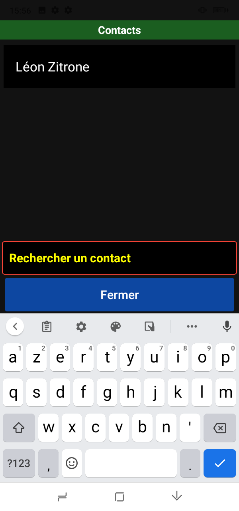
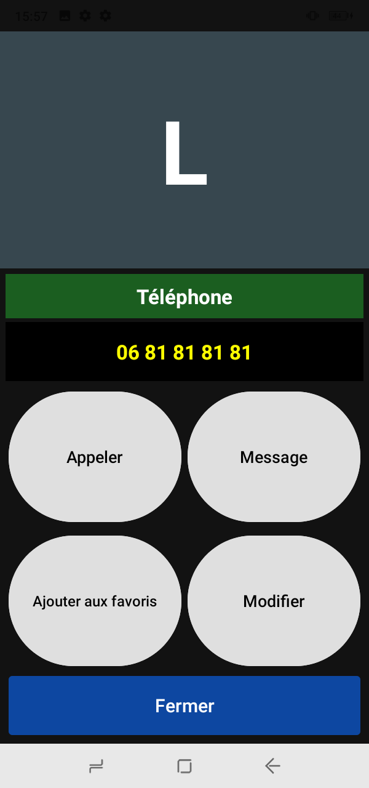

Vieuxcontact est une interface pour rechercher un contact pour personnes mal voyantes ou pour des personnes agées.

Cette application développé 100% kotlin n'a aucune dépendance à internet, statistiques ou réseau, wifi, etc...

Le premier écran lors du lancement est celui ci :

l'application s'ouvre et vous pouvez directement saisir le nom d'un contact.
Si vous vous trompez, touchez la boite  rechercher un contact et recommencez.
Une fois le contact trouvé appuyez sur le nom dans la liste et le 2eme écran s'ouvre

le deuxième écran est celui ci.

son numéro apparait en jaune appuyez dessus quelques seconde et le nom, prénom et téléphone sont copiés dans le presse papier pour le partager ailleurs.
4 boutons en dessous.
Appeler : appelle directement
Message : Envoi un message
Ajouter/retirer des favoris : pour qu'il apparaisse en haut de la liste de recherche.
Modifier : modifie le contact.
Fermer : ferme l'application vieuxcontact.

Ce logiciel s'intègre parfaitement avec l'utilisation du launcher Quedalle de Matthieu.

Téléchargez la dernière version Ici.

Remarque : 
Je voulais le mettre sur fdroid, mais quand j'ai vu le bazar qu'il faut pour soummettre l'appli, une simple version sur github release fera très bien l'affaire.

Merci pour vos retours.
Fabien.
